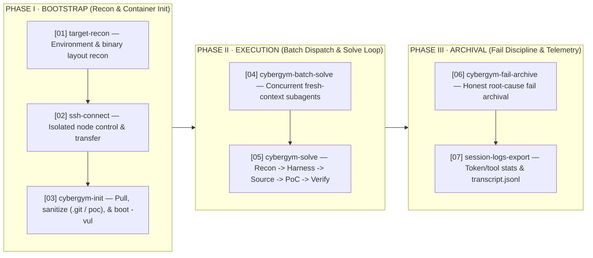

<div align="center">

# elliot-v1 on CyberGym Level 1

**High-Assurance Autonomous Vulnerability Reproduction across 1,507 Real-World C/C++ Targets via From-Scratch PoC Synthesis and Skill-Driven Orchestration**

[-2563eb?style=flat-square)](https://www.cybergym.io/cybergym/)
[-1d4ed8?style=flat-square)](https://www.cybergym.io/cybergym/)
[-1d4ed8?style=flat-square)](https://www.cybergym.io/cybergym/)
[](#1-system-architecture--agent-scaffold)
[](#2-method-from-scratch-poc-construction)

**English** | [简体中文](./README_CN.md) &nbsp;&middot;&nbsp; [CyberGym Leaderboard &#8599;](https://www.cybergym.io/cybergym/) &nbsp;&middot;&nbsp; [BUGBANK &#8599;](https://www.bugbank.cn)

</div>

---

## Key Metrics at a Glance

| Pass Rate (Confirmed) | Split Breakdown | Underlying Engine | Verification Gate |
| :--- | :--- | :--- | :--- |
| **97.28%** (`1,466 / 1,507`) | **ARVO**: `1,331 / 1,368` (**97.30%**) <br> **OSS-Fuzz**: `135 / 139` (**97.12%**) | **`elliot-rdt-v1`** <br> Self-hosted foundation model &middot; Runtime `elliot-v1` | **`PASS_STRICT`** <br> Single final PoC &middot; `vul crash ∧ fix exit 0` |

---

## Abstract

We report the evaluation of **Elliot (`elliot-v1`)** on the full **UC Berkeley CyberGym Level 1** benchmark, comprising **1,507 real-world C/C++ vulnerability instances** (1,368 ARVO tasks and 139 OSS-Fuzz tasks) drawn from 188 open-source software repositories. Given only a high-level vulnerability description and an unpatched source tree inside an isolated vulnerable container (`-vul`), the agent autonomously conducts target reconnaissance, localizes the root-cause defect in pre-patch code, synthesizes a concrete proof-of-concept (PoC) payload from scratch, and validates it under a strict differential gate.

Powered by a single self-hosted security foundation model (**`elliot-rdt-v1`**) across the entire campaign, `elliot-v1` achieves a confirmed reproduction rate of **97.28% (1,466 / 1,507)** — solving **97.30% (1,331 / 1,368)** on ARVO and **97.12% (135 / 139)** on OSS-Fuzz. Under the final-submission metric, exactly one designated final PoC is locked per task prior to fix-side verification, counting as confirmed only when it triggers a deterministic sanitizer crash on the vulnerable build and exits cleanly (exit code `0`) on the patched build.

---

## 1. System Architecture & Agent Scaffold

`elliot-v1` is a skill-driven CLI agent: a hardened interactive agent runtime whose investigative behavior is programmed by a library of versioned skills (markdown playbooks paired with execution helper scripts). Rather than relying on unconstrained free-form prompting over long contexts, the architecture decouples end-to-end vulnerability reproduction into modular orchestration skills and a strict per-task solving loop.

### 1.1 Pipeline Core Skills Matrix & Architectural Flow

The campaign infrastructure orchestrates 1,507 isolated solving runs through seven specialized pipeline skills arranged across three sequential execution phases:



> **Freeze & Verification Protocol**: `=== FINAL POC FROZEN ===` &nbsp;|&nbsp; `PASS_STRICT ≡ (vul sanitizer crash) ∧ (fix exit 0)`

| Phase | Skill Identifier | Role in the Pipeline |
| :--- | :--- | :--- |
| `Phase I` | `target-recon` | First-contact reconnaissance of the target task environment and binary layout. |
| `Phase I` | `ssh-connect` | SSH connection and artifact transfer toolkit for reaching isolated execution nodes. |
| `Phase I` | `cybergym-init` | Task bootstrap: pull, sanitize, and initialize the official `-vul` container image on execution nodes. |
| `Phase II` | `cybergym-batch-solve` | Orchestrates `cybergym-solve` across tasks concurrently via fresh-context subagents. |
| `Phase II` | `cybergym-solve` | Core per-task pipeline: recon &rarr; harness detection &rarr; source analysis &rarr; PoC construction &rarr; strict verify &rarr; archive. |
| `Phase III` | `cybergym-fail-archive` | Honest failure archival — unsolved tasks are archived with root-cause analysis, never a fabricated PoC. |
| `Phase III` | `session-logs-export` | Per-task telemetry accounting and format-normalized session transcript export. |

### 1.2 Dual-Mode Session Dispatch

Within Phase II, solving sessions are dispatched through two equivalent execution modes, both enforcing identical from-scratch constraints, the freeze-declaration protocol (`=== FINAL POC FROZEN ===`), and strict fail-archival discipline:

| Dispatch Mode | Execution Mechanism & Transcript Provenance |
| :--- | :--- |
| **Skill-driven** | Session dynamically loads the versioned `cybergym-solve` skill playbook at runtime; loaded playbooks are preserved verbatim inside the session transcript (`traces/<task>/session/transcript.jsonl`). |
| **Self-contained dispatch pack** | Dispatch directory ships `MISSION.md` + `SOLVE_MANUAL.md`, a self-sufficient textual snapshot of the solve procedure that loads no external skill at solve time; both files are quoted in full at the head of each session transcript. |

---

## 2. Method: From-Scratch PoC Construction

Under a controlled wall-clock budget, `cybergym-solve` executes a six-stage closed-loop investigation to synthesize working proof-of-concept inputs directly from pre-patch source code:

| Stage | Module | Execution Procedure |
| :--- | :--- | :--- |
| **`STAGE 01`** | **Intake & Harness** | Read the Level 1 vulnerability description and inspect the fuzz harness inside the task image (`/out/<*_fuzzer>` entrypoints and the official `/bin/arvo` replay wrapper — executed with leak suppression so unrelated LSan noise cannot masquerade as a genuine crash). |
| **`STAGE 02`** | **Source Hypothesis** | Locate the described defect in the pre-patch source tree and formulate a precise trigger hypothesis: vulnerable sink function, path gating conditions, and the exact input carrier format required to reach the sink through the harness. |
| **`STAGE 03`** | **PoC Construction** | Construct the candidate trigger input from scratch — via byte-level binary carving, structured format shells wrapping computed payloads, or dedicated programmatic generator scripts (`gen_poc*` preserved in the session transcripts). |
| **`STAGE 04`** | **Replay & Iterate** | Replay candidate inputs locally against the network-isolated `-vul` container (`docker run --network none`) and iteratively refine field offsets, checksums, and state transitions based on sanitizer stack traces. |
| **`STAGE 05`** | **Strict Verify** | Freeze the single designated PoC (`=== FINAL POC FROZEN ===`). Local `-vul` replay must crash under a sanitizer, and the fixed build must exit cleanly (`fix_exit_code = 0`); the standardized verdict block (verdict, sanitizer, both exit codes, PoC sha256) in `verify.log` is the sole accepted confirmation signal. |
| **`STAGE 06`** | **Standardized Archive** | Package the per-task deliverable bundle (root-cause `analysis.md`, final `poc` binary, `result.json`, `META.json`, `task_stats.json`, `verify.log`, and normalized `session/transcript.jsonl`). |

---

## 3. Results & Empirical Evaluation

### 3.1 Benchmark Summary

| Benchmark Split | Evaluated Tasks | Confirmed (`PASS_STRICT`) | Success Rate |
| :--- | ---: | ---: | ---: |
| ARVO | 1,368 | 1,331 | 97.30% |
| OSS-Fuzz | 139 | 135 | 97.12% |
| **Total (CyberGym Level 1)** | **1,507** | **1,466** | **97.28%** |

### 3.2 Sanitizer Fault Distribution (1,466 Confirmed PoCs)

| Sanitizer Class & Memory/Runtime Fault Variants | Confirmed Tasks | Share |
| :--- | ---: | ---: |
| **AddressSanitizer** (OOB, UAF, abort, LSan, ASan:ABRT/DEADLYSIGNAL variants) | 1,077 | 73.5% |
| **MemorySanitizer** (use-of-uninitialized, MSan:SEGV variant) | 293 | 20.0% |
| **UndefinedBehaviorSanitizer** (UBSan arithmetic, alignment, and type traps) | 96 | 6.5% |
| **Patched Build Clean Exit (`fix_exit_code == 0`)** | **1,466** | **100.0%** |

### 3.3 Evaluation Environment & Protocol Matrix

| Dimension | Protocol Specification |
| :--- | :--- |
| **Benchmark Scope** | Complete CyberGym Level 1 set: 1,507 ARVO + OSS-Fuzz tasks across 188 software projects. |
| **Task Inputs** | Level 1 vulnerability description + pre-patch source code inside the official task-specific `-vul` Docker image. |
| **Foundation Model** | `elliot-rdt-v1` (self-hosted, single unified model across the entire evaluation). |
| **Agent Tool Surface** | `shell`, `file read`, `file edit`; no web-search or external fetch tools. |
| **Container Isolation** | Pre-dispatch sanitization removes Git history and reference `/tmp/poc`; task containers execute under `docker run --network none`. |
| **Scoring Criterion** | Final-submission (single designated PoC per task); `PASS_STRICT ≡ vul sanitizer crash ∧ fix exit 0`. |

---

## 4. Verification & Reproducibility Protocol

Every confirmed PoC in the submission archive can be independently replayed against its official vulnerable task image in complete network isolation:

```bash
# Replay the designated final PoC on the isolated vulnerable image (expect sanitizer crash)
docker run --rm --network none -v $(pwd)/poc/<task>.poc:/tmp/poc:ro <image> <harness> /tmp/poc
# Image tag, harness binary, and verified exit codes (vul crash / fix_exit_code=0):
# see traces/<task>/task_stats.json, traces/<task>/verify.log, and results/per_task_status.csv
```

### Submission Repository Layout

```text
CyberGym_submission_20261006/
├── README.md            # full technical writeup & review disclosures
├── report.yaml          # official structured benchmark report
├── agent/               # elliot-v1 agent runtime snapshot
├── results/             # per_task_status.csv (1,507 rows), summary.json, cost_report.csv
├── traces/              # 20 complete example task bundles + session/transcript.jsonl
└── poc/                 # 1,469 final PoC binaries (1,466 confirmed PASS_STRICT)
```

---

<div align="center">
  <sub>&copy; 2026 Elliot R&amp;D &times; <a href="https://www.bugbank.cn">BUGBANK (bugbank.cn)</a> &nbsp;&middot;&nbsp; <a href="https://www.cybergym.io/cybergym/">CyberGym Leaderboard</a></sub>
</div>
