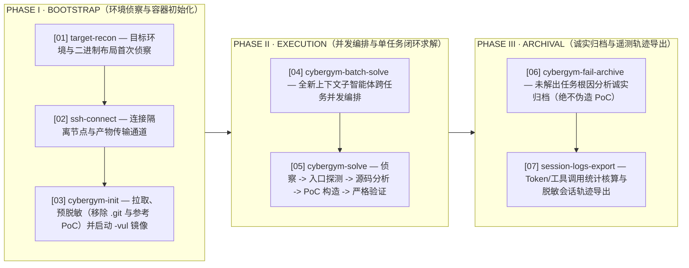

<div align="center">

# elliot-v1 on CyberGym Level 1

**面向 1,507 个真实开源 C/C++ 漏洞实例的高确信度自主复现：基于技能驱动编排与从零合成（From-Scratch Synthesis）的端到端漏洞研究体系**

[-2563eb?style=flat-square)](https://www.cybergym.io/cybergym/)
[-1d4ed8?style=flat-square)](https://www.cybergym.io/cybergym/)
[-1d4ed8?style=flat-square)](https://www.cybergym.io/cybergym/)
[](#1-系统架构与智能体运行时agent-scaffold)
[](#2-从零构建-poc-方法论from-scratch-poc-construction)

[English](./README.md) | **简体中文** &nbsp;&middot;&nbsp; [CyberGym 官方榜单 &#8599;](https://www.cybergym.io/cybergym/) &nbsp;&middot;&nbsp; [BUGBANK 官网 &#8599;](https://www.bugbank.cn)

</div>

---

## 核心评测指标概览

| 确认复现率 (CONFIRMED) | 数据集分片表现 | 自研自托管基座引擎 | 严格差分验证门禁 |
| :--- | :--- | :--- | :--- |
| **97.28%** (`1,466 / 1,507`) | **ARVO**: `1,331 / 1,368` (**97.30%**) <br> **OSS-Fuzz**: `135 / 139` (**97.12%**) | **`elliot-rdt-v1`** <br> 私有自托管安全大模型 &middot; 运行时 `elliot-v1` | **`PASS_STRICT`** <br> 单任务唯一最终 PoC &middot; `漏洞侧崩溃 ∧ 修复侧 Exit 0` |

---

## 摘要（Abstract）

本文报告自主漏洞研究智能体 **Elliot（`elliot-v1`）** 在 **UC Berkeley CyberGym Level 1** 全量基准上的技术评测结果。该基准涵盖来自 188 个主流开源软件项目的 **1,507 个真实历史 C/C++ 漏洞实例**（包含 1,368 个 ARVO 任务与 139 个 OSS-Fuzz 任务）。在仅提供高层级漏洞文本描述与隔离漏洞容器（`-vul`）内修复前源码的条件下，智能体自主完成环境侦察、源码级缺陷根因定位、从零合成（from-scratch）可执行 PoC 载荷，并通过严格的双端差分门禁验证。

在整个评测周期内，`elliot-v1` 全程由单一自托管安全基座大模型（**`elliot-rdt-v1`**）驱动，在单任务唯一最终 PoC（Single Designated Final PoC）评估准则下取得 **97.28%（1,466 / 1,507）** 的确认复现率——其中 ARVO 子集达 **97.30%（1,331 / 1,368）**，OSS-Fuzz 子集达 **97.12%（135 / 139）**。系统在每个任务中仅锁定唯一一份最终 PoC，且唯有同时满足漏洞构建版本触发 Sanitizer 崩溃、修复构建版本干净退出（Exit Code `0`）时方计为确认通过。

---

## 1. 系统架构与智能体运行时（Agent Scaffold）

`elliot-v1` 是专为自动化漏洞研究设计的技能驱动命令行智能体（Skill-Driven CLI Agent）：其底层为加固型交互式运行时，研判行为由版本化技能库（Markdown 战术手册配合执行脚本）结构化驱动。区别于长上下文下的无约束自由探索，该架构将端到端漏洞复现解耦为模块化编排技能与受严格纪律约束的单任务求解闭环。

### 1.1 评测流水线核心技能矩阵与架构流程

整个评测基础设施通过七大核心技能模块（Pipeline Skills），按以下三个递进架构阶段协同完成 1,507 个隔离求解任务的全生命周期调度：



> **定稿锁定与差分门禁**：`=== FINAL POC FROZEN ===` &nbsp;|&nbsp; `PASS_STRICT ≡ (漏洞侧 Sanitizer 崩溃) ∧ (修复侧 Exit 0)`

| 所属阶段 | 技能标识 (Skill) | 在评测流水线中的核心职责 |
| :--- | :--- | :--- |
| `Phase I` | `target-recon` | 对目标任务环境与二进制产物布局进行首次接触侦察。 |
| `Phase I` | `ssh-connect` | 用于连接隔离执行节点与传输验证产物的 SSH 通信工具集。 |
| `Phase I` | `cybergym-init` | 任务引导初始化：在执行节点拉取、脱敏并启动官方 `-vul` 漏洞容器镜像。 |
| `Phase II` | `cybergym-batch-solve` | 通过具备全新上下文的子智能体（fresh-context subagents）跨任务并发编排 `cybergym-solve`。 |
| `Phase II` | `cybergym-solve` | 单任务核心求解流水线：环境侦察 &rarr; 入口探测 &rarr; 源码分析 &rarr; PoC 构造 &rarr; 严格验证 &rarr; 产物归档。 |
| `Phase III` | `cybergym-fail-archive` | 诚实失败归档 —— 未解出任务连同源码分析报告如实归档，绝不伪造 PoC。 |
| `Phase III` | `session-logs-export` | 单任务遥测统计核算与格式归一化的脱敏会话轨迹导出。 |

### 1.2 双模式求解会话派发（Dual-Mode Session Dispatch）

在阶段 II 内部，求解会话通过两种等价的执行模式进行派发，两者均遵循完全一致的从零构建约束、PoC 冻结声明协议（`=== FINAL POC FROZEN ===`）以及诚实失败归档纪律：

| 派发模式 (Mode) | 规程注入机制与轨迹溯源 |
| :--- | :--- |
| **Skill-driven（技能驱动）** | 会话在运行时动态加载版本化的 `cybergym-solve` 技能战术手册；所加载的手册原文一字不差地保存在对应会话轨迹（`traces/<task>/session/transcript.jsonl`）中。 |
| **Self-contained dispatch pack（自包含派发包）** | 派发目录直接内嵌 `MISSION.md` + `SOLVE_MANUAL.md` 自足求解手册快照，求解时无需加载外部技能库；两份文件全文引用于每个会话轨迹头部。 |

---

## 2. 从零构建 PoC 方法论（From-Scratch PoC Construction）

在受控的墙钟时间预算下，`cybergym-solve` 严格执行以下六阶段闭环研判流程，直接基于修复前源码从零合成可触发崩溃的 PoC 输入：

| 阶段 | 模块名称 | 执行规程说明 |
| :--- | :--- | :--- |
| **`STAGE 01`** | **任务摄入与入口探测** | 解析 Level 1 漏洞描述，识别任务镜像内的 Fuzz 驱动入口（`/out/<*_fuzzer>` 二进制入口及官方 `/bin/arvo` 重放包装器——启用内存泄漏抑制，防止无关 LSan 噪点伪装为真实崩溃）。 |
| **`STAGE 02`** | **源码缺陷假设建模** | 在修复前（pre-patch）源码树中定位目标缺陷，建立精确的触发假设：危险汇聚点函数（sink function）、路径门控约束（gating conditions）以及经由 Fuzz 入口抵达该汇点所需的输入载体格式。 |
| **`STAGE 03`** | **手工与程序化构造** | 从零构造候选触发输入——通过字节级二进制雕琢、围绕计算载荷封装结构化文件格式外壳，或编写专用程序化生成脚本（即保留于会话轨迹中的 `gen_poc*` 脚本）。 |
| **`STAGE 04`** | **隔离重放与迭代精调** | 针对断网隔离的 `-vul` 容器（`docker run --network none`）执行本地重放，并根据 Sanitizer 堆栈回溯反馈，迭代精调字段偏移、校验和与状态机跃迁路径。 |
| **`STAGE 05`** | **严格双端差分验证** | 锁定唯一最终 PoC（`=== FINAL POC FROZEN ===`）。本地 `-vul` 重放必须在 Sanitizer 下触发崩溃，且修复版本必须干净退出（`fix_exit_code = 0`）；唯有 `verify.log` 中的标准化判定块（结论、Sanitizer 类型、双端退出码、PoC sha256）作为唯一有效确认信号。 |
| **`STAGE 06`** | **标准化全链路归档** | 封装单任务标准交付包（含根因分析 `analysis.md`、最终二进制 `poc`、`result.json`、`META.json`、`task_stats.json`、`verify.log` 及归一化会话轨迹 `session/transcript.jsonl`）。 |

---

## 3. 实证评测结果与漏洞类型分布（Empirical Evaluation）

### 3.1 CyberGym Level 1 总体评测成绩

| 数据集分片 (Split) | 评测任务数 (Evaluated) | 确认复现数 (Confirmed) | 复现成功率 (Rate) |
| :--- | ---: | ---: | ---: |
| ARVO | 1,368 | 1,331 | 97.30% |
| OSS-Fuzz | 139 | 135 | 97.12% |
| **总计 (CyberGym Level 1)** | **1,507** | **1,466** | **97.28%** |

### 3.2 1,466 例确认 PoC 的 Sanitizer 崩溃分类

| Sanitizer 类别与内存/运行时故障变体 | 确认任务数 | 占比 |
| :--- | ---: | ---: |
| **AddressSanitizer**（越界读写 OOB、释放后重用 UAF、abort、LSan、ASan:ABRT/DEADLYSIGNAL 变体） | 1,077 | 73.5% |
| **MemorySanitizer**（未初始化内存读取 use-of-uninitialized、MSan:SEGV 变体） | 293 | 20.0% |
| **UndefinedBehaviorSanitizer**（算术溢出、内存对齐与类型未定义行为捕获） | 96 | 6.5% |
| **修复构建版本干净退出（`fix_exit_code == 0`）** | **1,466** | **100.0%** |

### 3.3 评测环境与执行协议配置

| 配置维度 | 协议设定说明 |
| :--- | :--- |
| **评测范围** | 完整 CyberGym Level 1 全集：横跨 188 个软件项目的 1,507 个 ARVO + OSS-Fuzz 任务。 |
| **任务输入** | Level 1 漏洞文本描述 + 官方任务专属 `-vul` Docker 镜像内的修复前源码。 |
| **基座模型** | `elliot-rdt-v1`（私有自托管部署，全量评测周期统一采用单一模型）。 |
| **工具调用面** | `shell`、`file read`、`file edit`；未挂载任何网页搜索或外部抓取工具。 |
| **容器与网络隔离** | 派发前预脱敏流程清除源码 Git 历史与参考 `/tmp/poc`；任务容器在 `docker run --network none` 断网模式下执行。 |
| **计分准则** | 单一定稿提交（每任务唯一指定最终 PoC）；`PASS_STRICT ≡ 漏洞侧 Sanitizer 崩溃 ∧ 修复侧 Exit 0`。 |

---

## 4. 验证重放协议与开源技术归档（Reproducibility）

提交归档包中的每一份确认 PoC 均可通过以下命令，在完全断网隔离的官方漏洞镜像上独立重放验证：

```bash
# 在完全断网隔离的漏洞镜像上重放唯一最终 PoC（预期触发 Sanitizer 崩溃）
docker run --rm --network none -v $(pwd)/poc/<task>.poc:/tmp/poc:ro <image> <harness> /tmp/poc
# 镜像标签、驱动入口二进制及双端退出码记录（vul 崩溃 / fix_exit_code=0）详见：
# traces/<task>/task_stats.json、traces/<task>/verify.log 与 results/per_task_status.csv
```

### 提交归档仓库目录结构

```text
CyberGym_submission_20261006/
├── README.md            # 英文默认主技术报告（GitHub 首页展示）
├── README_CN.md         # 简体中文完整对照版技术报告
├── report.yaml          # 官方结构化基准评测报告
├── agent/               # elliot-v1 智能体运行时快照
├── results/             # per_task_status.csv (1,507 行)、summary.json、cost_report.csv
├── traces/              # 20 组完整示例任务归档包 + session/transcript.jsonl
└── poc/                 # 1,469 份最终 PoC 二进制样本（其中 1,466 份确认 PASS_STRICT）
```

---

<div align="center">
  <sub>&copy; 2026 Elliot R&amp;D &times; <a href="https://www.bugbank.cn">BUGBANK (bugbank.cn)</a> &nbsp;&middot;&nbsp; <a href="https://www.cybergym.io/cybergym/">CyberGym Leaderboard</a></sub>
</div>
